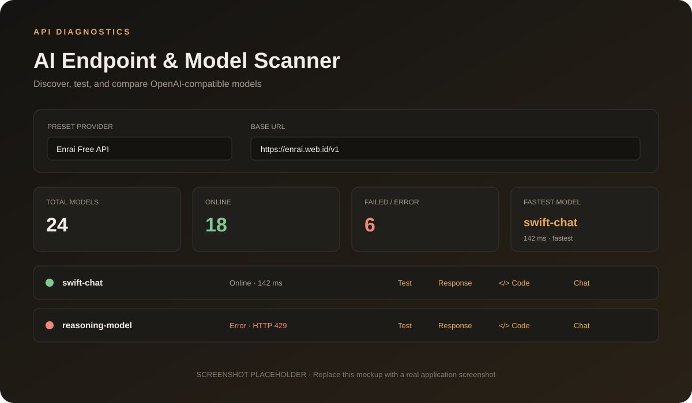

# AI Endpoint & Model Scanner

[](https://enraidev.github.io/ai-endpoint-scanner/)
[](https://enraidev.github.io/ai-endpoint-scanner/)

**Live demo:** <https://enraidev.github.io/ai-endpoint-scanner/> — runs fully in the browser via direct fetch (no PHP required). Self-host with XAMPP/PHP to use the `api.php` proxy instead.

A lightweight native-PHP dashboard for discovering models on OpenAI-compatible APIs, checking availability and latency, and trying models interactively. No framework, Composer install, Node build, or third-party frontend library is required.



> **Screenshot:** A placeholder image is included at `docs/images/dashboard-placeholder.svg`. Replace it with a real dashboard capture before publishing if desired.

## Features

- Scan OpenAI-compatible `/models` endpoints and inspect structured responses.
- Test models sequentially; inspect HTTP status, server-measured latency, model output, and raw response.
- Summary cards for total, online, failed/error, and fastest model; filter by status and sort by latency.
- Provider presets for Enrai Free API, OpenRouter, Groq, Localhost/9Router, and custom endpoints.
- Mask/reveal API key; save configuration locally in browser `localStorage`.
- Configurable delay between Test All requests (default 3000 ms) to help reduce rate-limit errors.
- Per-model snippets: cURL, Python (`openai`), JavaScript (`fetch`), and PHP (cURL).
- Per-model Quick Chat drawer with temporary conversation history, typing indicator, and Clear Chat.
- Responsive native HTML/CSS/JavaScript frontend and PHP cURL backend, without frontend dependencies.
- **Dual-mode requests:** automatic PHP proxy (`api.php`) with direct browser fetch fallback, plus an `Auto` / `PHP Proxy` / `Direct Browser` selector and a live mode badge.

## Requirements

- An OpenAI-compatible API endpoint. Some providers require an API key.
- **Optional (proxy mode):** PHP 7.4+ (PHP 8+ recommended) with the cURL extension enabled, served by Apache/XAMPP or PHP's built-in development server.
- No PHP is needed for the static build: the page also calls the provider directly from the browser (see [Dual mode](#dual-mode-github-pages-vs-xamppphp)).

## Run with XAMPP

1. Copy `index.html` and `api.php` into your XAMPP web root, e.g. `C:\xampp\htdocs\tester\`.
2. Start **Apache** in the XAMPP Control Panel.
3. Open `http://localhost/tester/` in a modern browser. Do not open the file through `file://`: the frontend calls `api.php` with `fetch()`.
4. Choose a provider preset (or Custom Endpoint), enter an API key if required, then click **Scan Models**.
5. Test an individual model, open **Code** or **Chat**, or run **Test All Models**. Adjust Delay (ms) to suit provider rate limits.

Enable `extension=curl` in the `php.ini` used by Apache if required, then restart Apache.

## Run with PHP's built-in server

From the project directory:

```bash
php -S 127.0.0.1:8000
```

Open <http://127.0.0.1:8000/>. This server is for local development and demos, not production deployment.

## Dual mode: GitHub Pages vs XAMPP/PHP

The same `index.html` works in two modes and picks one automatically:

| Mode | When it is used | How requests are made |
| --- | --- | --- |
| **PHP proxy** | The page is served by Apache/XAMPP or PHP's built-in server and `api.php` answers with JSON | `POST api.php` → server-side cURL to `<base_url>/models` and `<base_url>/chat/completions`. No CORS restrictions. |
| **Direct browser fetch** | The page is served from a static host (any `*.github.io` domain or `file://`), or `api.php` returns raw `<?php` source, a non-JSON body, HTTP 404, or HTTP 405 | The browser calls `<base_url>/models` (`GET`) and `<base_url>/chat/completions` (`POST`) itself, sends `Content-Type: application/json` plus `Authorization: Bearer <api key>` when a key is filled in, and measures latency with `performance.now()`. |

Use the **Mode koneksi** selector to override the automatic choice: `Auto` (default), `PHP Proxy`, or `Direct Browser Fetch`. The badge beside it shows the mode in use, including `fallback dari PHP` when a proxy call failed and the request was retried directly.

Direct mode limitation: the provider must allow cross-origin requests (CORS) from this origin. When it does not, the browser blocks the response and the app reports *"Request diblokir CORS oleh provider; jalankan via XAMPP/PHP lokal untuk bypass CORS."* Run the PHP proxy (XAMPP or your own server) to bypass CORS. In direct mode the API key travels from the browser straight to the provider.

## Proxy API

`api.php` accepts JSON `POST` requests:

- `scan`: GET `<base_url>/models`.
- `test_model`: POST a single user prompt to `<base_url>/chat/completions`.
- `chat`: POST bounded conversation history to `<base_url>/chat/completions`.

All actions require `base_url` beginning with `http://` or `https://`. Responses include `success`, `http_code`, `latency_ms`, `reply_text`, and `raw_response` where applicable. cURL TLS certificate verification is enabled; configure PHP's CA bundle if needed rather than disabling TLS verification.

## Security & privacy

This is a **development/demo utility**, not an authenticated multi-user service. Do not expose an unrestricted public instance: the proxy can be abused to access arbitrary HTTP(S) endpoints (SSRF) or spend provider quota. Before public hosting, restrict permitted hosts, add authentication and rate limits, and use HTTPS.

API keys are stored in browser `localStorage` and sent to your PHP server for proxying. Avoid shared/public computers and clear saved browser data after use. Show/Hide only changes visual masking. Never publish real API keys, chat transcripts, or unredacted screenshots. Latency is one observation and varies with network and provider load.


---

## Bahasa Indonesia

**Live demo:** <https://enraidev.github.io/ai-endpoint-scanner/> — berjalan penuh di browser lewat direct fetch (tanpa PHP). Self-host dengan XAMPP/PHP untuk memakai proxy `api.php`.

Dashboard native PHP yang ringan untuk menemukan model pada endpoint OpenAI-compatible, memeriksa ketersediaan dan latency, serta mencoba model secara langsung. Tidak membutuhkan framework, Composer, proses build Node, atau library frontend eksternal.


> **Screenshot:** Berkas placeholder tersedia di `docs/images/dashboard-placeholder.svg`. Ganti dengan screenshot dashboard asli sebelum publikasi jika diperlukan.

### Fitur

- Scan endpoint `/models`; uji model berurutan dan lihat status HTTP, latency, balasan, serta raw response.
- Kartu statistik total, online, gagal/error, dan model tercepat; filter status dan sorting latency.
- Preset Enrai Free API, OpenRouter, Groq, Localhost/9Router, dan Custom Endpoint.
- API key dapat disamarkan/ditampilkan; konfigurasi tersimpan di `localStorage` browser.
- Delay antar-request Test All bisa diatur (default 3000 ms) untuk membantu mengurangi error rate limit.
- Snippet per model siap salin: cURL, Python (`openai`), JavaScript (`fetch`), dan PHP (cURL).
- Quick Chat drawer dengan riwayat percakapan sementara, indikator mengetik, dan tombol Clear Chat.
- Frontend native yang responsif, backend PHP cURL, tanpa dependensi frontend.
- **Mode ganda:** proxy PHP (`api.php`) dengan fallback direct fetch dari browser, plus selector `Auto` / `PHP Proxy` / `Direct Browser` dan badge mode aktif.

### Instalasi di XAMPP

1. Salin `index.html` dan `api.php` ke web root XAMPP, misalnya `C:\xampp\htdocs\tester\`.
2. Jalankan **Apache** dari XAMPP Control Panel.
3. Buka `http://localhost/tester/` di browser. Jangan buka berkas melalui `file://` karena aplikasi memanggil `api.php` dengan `fetch()`.
4. Pilih preset provider (atau Custom Endpoint), masukkan API key bila diperlukan, lalu klik **Scan Models**.
5. Uji model, buka **Code** atau **Chat**, atau jalankan **Test All Models**. Sesuaikan Delay (ms) dengan batas provider.

Pastikan ekstensi `extension=curl` aktif di `php.ini` yang digunakan Apache, kemudian restart Apache.

### Menjalankan PHP server

Dari direktori proyek:

```bash
php -S 127.0.0.1:8000
```

Buka <http://127.0.0.1:8000/>. Server bawaan PHP ditujukan hanya untuk development/demo lokal.

### Mode ganda: GitHub Pages vs XAMPP/PHP

Halaman yang sama berjalan dalam dua mode dan memilih otomatis:

| Mode | Kapan dipakai | Cara request |
| --- | --- | --- |
| **PHP proxy** | Halaman dilayani Apache/XAMPP atau PHP built-in server dan `api.php` membalas JSON | `POST api.php` → cURL di sisi server ke `<base_url>/models` dan `<base_url>/chat/completions`. Bebas CORS. |
| **Direct browser fetch** | Halaman dilayani host statis (`*.github.io`, `file://`), atau `api.php` mengembalikan kode `<?php` mentah, respons non-JSON, HTTP 404, atau 405 | Browser memanggil `<base_url>/models` (GET) dan `<base_url>/chat/completions` (POST), mengirim `Content-Type: application/json` dan `Authorization: Bearer <api key>` bila key diisi, lalu mengukur latency dengan `performance.now()`. |

Selector **Mode koneksi** menimpa pilihan otomatis: `Auto` (default), `PHP Proxy`, atau `Direct Browser Fetch`. Badge di sebelahnya menampilkan mode yang sedang aktif, termasuk `fallback dari PHP` saat request proxy gagal dan diulang langsung dari browser.

Batas mode direct: provider harus mengizinkan CORS dari origin ini. Jika tidak, browser memblokir respons dan aplikasi menampilkan pesan *"Request diblokir CORS oleh provider; jalankan via XAMPP/PHP lokal untuk bypass CORS."* Jalankan proxy PHP (XAMPP atau server sendiri) untuk melewati CORS. Pada mode direct, API key dikirim langsung dari browser ke provider.

### Keamanan

Aplikasi ini adalah utilitas demo dan belum memiliki autentikasi multi-user. **Jangan mengekspos instance publik tanpa pembatasan host, autentikasi, rate limit, dan HTTPS.** Proxy yang terbuka dapat disalahgunakan untuk SSRF ke endpoint HTTP(S) sembarang atau menghabiskan kuota API. API key disimpan di `localStorage`; hindari komputer publik dan hapus data browser setelah selesai. Show/Hide hanya menyamarkan tampilan. Verifikasi sertifikat TLS cURL tetap aktif. Jangan publikasikan API key, riwayat chat, atau screenshot yang berisi rahasia.

Lihat bagian berbahasa Inggris di atas untuk detail API proxy, layout repositori, kontribusi, dan konfigurasi CA bundle.
## Repository layout

```text
.
├── api.php       # PHP cURL proxy
├── index.html    # Single-page dashboard
└── README.md
```

## Contributing

Bug reports and pull requests are welcome. Include PHP version, browser, endpoint type, reproduction steps, and redacted logs/screenshots. Never include secrets.
